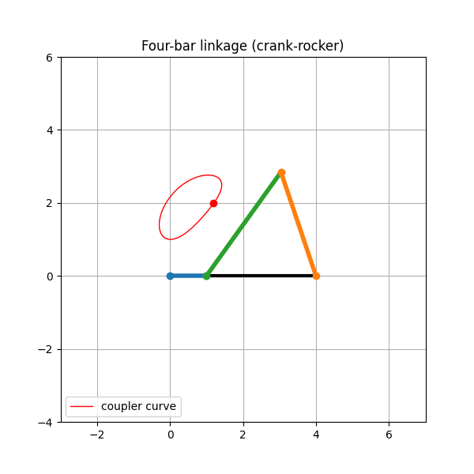
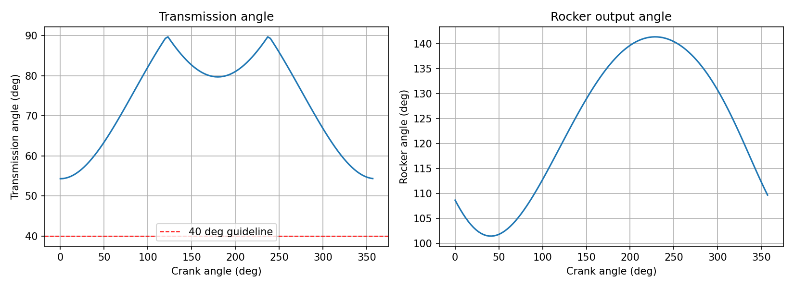

# Four-Bar Linkage Analysis

Position, transmission angle and coupler curve analysis of a planar four-bar linkage in Python.

## Features
- Grashof classification (crank-rocker, double-crank, double-rocker, non-Grashof)
- Position analysis by circle intersection (two assembly configurations)
- Coupler curve of a point attached to the coupler
- Transmission angle over a full crank rotation
- Animation of the mechanism

## Method

Links: ground `g`, crank `a`, coupler `b`, rocker `c`. The crank pin A lies at
`(a·cosθ2, a·sinθ2)`. The joint B is the intersection of a circle of radius `b`
around A and a circle of radius `c` around the rocker pivot O4 = (g, 0).

Grashof condition (shortest `s`, longest `l`, others `p`, `q`):

    s + l <= p + q

If it holds, the shortest link can make a full rotation. If the shortest link
is the crank, the mechanism is a crank-rocker.

Transmission angle: the angle between the coupler and the rocker at joint B,
reported in the range 0-90 degrees. A common design guideline is to keep it
above about 40 degrees.

## Example result

Link lengths: ground = 4.0, crank = 1.0, coupler = 3.5, rocker = 3.0 (arbitrary units).

| Quantity | Value |
|---|---|
| Type | Grashof crank-rocker |
| Min transmission angle | 54.3 deg |
| Max transmission angle | 89.7 deg |
| Rocker swing | 40.0 deg (101.4 to 141.4 deg) |

## Installation

    pip install numpy matplotlib

## Usage

    python demo.py

The animation and plots are saved to the `assets/` folder.

## Project structure

    linkage.py   position analysis, Grashof check, transmission angle
    demo.py      crank-rocker example, animation and plots
    assets/      generated images

## Future work
- Velocity and acceleration analysis
- Synthesis: find link lengths for a required rocker swing
- Slider-crank mechanism
